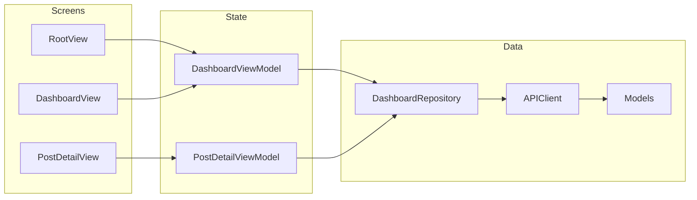

# InsightBoard

InsightBoard is a responsive operations dashboard for a small publishing workspace. It loads people, posts, comments, tasks, and albums from the public [JSONPlaceholder](https://jsonplaceholder.typicode.com) API, then lays that data out for both iPhone and iPad.

The app is written in SwiftUI. Networking uses `async`/`await`. JSON is decoded into plain models. The interface has a loading state, an error state with retry, an empty workspace state, and a search state for when nothing matches.

## Requirements

| Requirement | Where it is covered |
| --- | --- |
| SwiftUI dashboard fed by a public mock API | `LiveDashboardRepository` loads JSONPlaceholder |
| `async`/`await` networking and JSON models | `APIClient`, `APIEndpoint`, `Models/` |
| Layout adapts across iPhone and iPad | `RootView` uses the horizontal size class, not the device type |
| Loading and error states | `DashboardLoadingView`, `ErrorStateView`, comment states on the post screen |
| Empty state | Empty workspace, no search results, and a post with no comments |
| Repo and walkthrough | This file, plus the recording script below |

## Setup and how to run

You need one Mac. Nothing else has to be installed besides Xcode.

### What you need

| Requirement | Details |
| --- | --- |
| Computer | A Mac. This is an iOS app, so it cannot run on Windows or in a browser. |
| Xcode | Xcode 26 or later. The project targets iOS 26.2. Older Xcode cannot build it. |
| Apple account | Not required. The Simulator does not need a paid developer account. |
| Internet | Required the first time, so the app can reach JSONPlaceholder. No API key. |
| Extra tools | None. Do not run `pod install`, `npm install`, or Swift Package Manager. |

Install Xcode from the Mac App Store if it is not already installed. Open it once and let it finish the extra components. If macOS asks you to install the command-line tools, accept that too.

### Get the project

If you received a Git link:

1. Open Terminal.
2. Run `git clone <repository-url>`.
3. Run `cd InsightBoard`.

If you received a zip file, unzip it and open the `InsightBoard` folder. The important file is `InsightBoard.xcodeproj`.

### Run it on an iPhone simulator

1. Double-click `InsightBoard.xcodeproj`. It opens in Xcode. Do not open the folder in another editor and expect the app to launch.
2. Wait until the top progress bar finishes. The first open can take a minute.
3. At the top of the window, set the scheme to **InsightBoard**.
4. Next to the scheme, set the run destination to any iPhone simulator whose iOS version is 26 or later, such as **iPhone 17**.
5. If that menu has no iPhone, choose **Xcode > Settings > Components** (or **Platforms**) and download an iOS 26 simulator runtime. Then pick the iPhone again.
6. Press the Run button, or press **Command-R**.
7. The Simulator app opens. The first build can take a few minutes. Later runs are faster.

When it works, the screen title is **InsightBoard**. After a short load you should see four numbers: **10** people, **100** posts, **500** comments, and **100** albums. Scroll down for tasks, the team, and the post list. Tap a post to open it.

The Mac must be online for that first load. JSONPlaceholder is a public sample API at `https://jsonplaceholder.typicode.com`. The project does not contain a password or an API key. The API is served over HTTPS, so no App Transport Security exception is required.

### Run the same build on an iPad

1. Stop the app with the Stop button, or press **Command-.**.
2. Change the run destination from the iPhone to an iPad simulator, such as **iPad Pro 11-inch (M5)** or **iPad (A16)**.
3. Press Run again.

On the iPad the four metric cards sit in one row. Tap a post and it opens beside the list instead of replacing the screen.

### If it does not start

| What you see | What to do |
| --- | --- |
| "Unable to Load" and a message about the internet | Turn Wi-Fi on, then tap **Try Again**. Airplane Mode on the simulator also causes this. |
| No iPhone or iPad in the destination menu | Download an iOS 26 simulator runtime from **Xcode > Settings > Components**. |
| Xcode says the project needs a newer version | Install Xcode 26 or later. The deployment target is iOS 26.2. |
| Signing error on a real iPhone | Use a simulator instead. A physical device needs an Apple ID under **Signing & Capabilities**, and this assignment does not require a device. |
| Build failed on a missing package | There are no packages to install. Open `InsightBoard.xcodeproj` and run the **InsightBoard** scheme. |

## Walkthrough

Record the Simulator window with QuickTime Player (**File > New Screen Recording**) or the macOS screenshot toolbar (**Command-Shift-5**). Crop to the simulator. A clear pass is about three minutes. Suggested simulators: any recent iPhone, then an iPad.

Say this, or a shorter version in your own words. The actions matter more than the exact sentences.

### Before you record

JSONPlaceholder usually answers in a fraction of a second, so the loading skeleton can flash past. To hold it on screen:

1. In Xcode, choose **Product > Scheme > Edit Scheme…**
2. Open **Run > Arguments**
3. Add `-slowLoad` under **Arguments Passed On Launch**
4. Close the scheme editor and run

`-slowLoad` is a debug-only pause. It waits about two seconds before the dashboard appears, and about one second before comments appear. Remove the argument after filming if you want the submitted scheme to launch at full speed. The loading UI is real either way. The argument only keeps it visible.

### Shot list

**1. Open the project — about 20 seconds**

Show the `InsightBoard` group in the navigator: `Models`, `Networking`, `Repository`, `Features/Dashboard`, `Features/PostDetail`.

> “InsightBoard is a SwiftUI dashboard. Models decode the JSON, a small API client does the networking with async/await, and the screens only talk to a repository. Views never call URLSession.”

**2. iPhone, loading — about 10 seconds**

Launch on an iPhone simulator with `-slowLoad` enabled.

> “On launch the screen stays in a loading state until every request finishes. The skeleton matches the dashboard, and the status says the workspace is being fetched.”

**3. iPhone, loaded dashboard — about 30 seconds**

Scroll from the metrics to the task card, the team rail, and the post list.

> “These numbers are the live payload: people, posts, comments, and albums. Tasks show how much of the to-do list is complete, and the open items underneath. The team is the user list. Posts are newest first, with the author and comment count.”

**4. Search, then the empty search state — about 20 seconds**

Tap Search. Type `qui` and show the filtered posts. Clear it and type `zzzz`.

> “Search filters posts and authors on device. A query with no matches uses the system empty search state. Clearing the query brings the dashboard back.”

**5. Post and comments — about 25 seconds**

Clear the search. Tap a post. Wait for the comments.

> “The post opens with its author. Comments are a second request, `/posts/{id}/comments`, so this screen has its own loading state. If that request fails, the post stays readable and the comments section can be retried.”

Tap Back.

**6. Error, then recovery — about 30 seconds**

In the simulator, open **Settings**, turn on **Airplane Mode**, and return to InsightBoard. Tap the refresh button in the toolbar.

> “Refresh asks for the workspace again. With no connection, the client maps the URL error to a plain message and the screen offers Try Again.”

Turn Airplane Mode off. Tap **Try Again**.

> “The same action loads the dashboard once the network is back.”

**7. iPad — about 40 seconds**

Stop the app, switch the run destination to an iPad simulator, and run it. Do not select a post yet. Then select one. Rotate the iPad, or drag the app into a narrow Split View.

> “The layout follows the size class, not the device name. On a regular width the metrics sit in one row of four. Choosing a post opens it beside the dashboard, and the metrics reflow into two columns so the list stays readable. The selected card is marked. Closing the post gives the dashboard the full width again. In a narrow width, including iPhone and a slim iPad Split View, the post is pushed on the navigation stack instead.”

Stop the recording.

### What the video needs to show

- Loading skeleton on launch
- The loaded dashboard
- Search with no results
- A post with its comments
- The error screen and Try Again
- The same app on iPad, with the side-by-side post

The empty workspace and the “no comments” screen are in the Xcode previews (`Empty`, `Post without comments`) if you also want those on camera. The live API returns posts and comments, so search is the empty state you can reach without a preview.

## Architecture

```text
RootView
  └── DashboardView / PostDetailView
        └── DashboardViewModel / PostDetailViewModel
              └── DashboardRepository
                    └── APIClient
                          └── JSONPlaceholder
```

Views render state. View models own loading, search, and selection. The repository is the only type that knows how a dashboard is assembled. The API client is the only type that knows about URLs, status codes, and `JSONDecoder`.

That split is what makes the previews work. `PreviewRepository` returns fixed models, so the loading, error, empty, and loaded screens can be opened in the canvas without the network.



### Folder map

```text
InsightBoard/
├── InsightBoardApp.swift          App entry. Builds the live repository.
├── RootView.swift                 iPhone stack and iPad two-column shell.
├── Design/                        Spacing, cards, avatars, text cleanup.
├── Models/                        Codable types and DashboardSnapshot.
├── Networking/                    Endpoint, client, user-facing errors.
├── Repository/                    Parallel fetch of the five resources.
├── Features/Dashboard/            Dashboard state, cards, loading, error, empty.
├── Features/PostDetail/           Post reader and comment request.
└── PreviewSupport/                Sample data and SwiftUI previews.
```

Xcode uses a synchronized folder, so new Swift files under `InsightBoard/` are part of the target without a manual project edit.

## Networking

`APIEndpoint` builds a `URLRequest` for:

| Endpoint | Use |
| --- | --- |
| `GET /users` | Team |
| `GET /posts` | Post list |
| `GET /comments` | Comment counts on each post |
| `GET /todos` | Task progress and open tasks |
| `GET /albums` | Album metric |
| `GET /posts/{id}/comments` | Comments on the post screen |

`LiveDashboardRepository.loadDashboard()` starts the five dashboard requests with `async let`, then waits for all of them. One failure fails the load. The screen does not show a half-loaded workspace.

```swift
async let users: [User] = client.fetch(.users)
async let posts: [Post] = client.fetch(.posts)
async let comments: [Comment] = client.fetch(.comments)
async let todos: [Todo] = client.fetch(.todos)
async let albums: [Album] = client.fetch(.albums)
```

`APIClient.fetch` checks the HTTP status, decodes the body into the requested model, and turns transport and decoding failures into `APIError`. The view models never show `URLError` text. Offline, timeout, a bad status, and unreadable JSON each get a short message. A cancelled request is ignored so leaving a screen does not look like a failure.

Pull to refresh and the toolbar refresh button call the same `load()` method. The first load replaces the screen with the skeleton. A later refresh keeps the current dashboard on screen until the new data, or the error state, arrives.

## Models

The model properties match the JSON names, including `userId`, `postId`, and `catchPhrase`. Nested user fields (`address`, `geo`, `company`) are decoded as nested structs. `lat` and `lng` stay strings because that is how the API sends them.

`DashboardSnapshot` is the value the dashboard renders. It sorts people by name and posts newest-first, and it builds lookups for “who wrote this post” and “how many comments does it have” so the list does not scan the full arrays for every row.

Titles from JSONPlaceholder are lowercase sentences. `DisplayText.sentenceCase` fixes the first letter for display. The stored model is still the raw API value.

## Screens

**Dashboard.** Metric cards, task completion, a horizontal team rail, and the post list.

**Search.** Filters by post title, post body, author name, and username. A query with no matches shows `ContentUnavailableView.search`.

**Post.** Title, body, author, city, email, and website, then comments. The comment request has its own loading, empty, and error states. Email and website are links.

**States**

| State | What you see | How to reach it |
| --- | --- | --- |
| Loading | Skeleton and “Fetching the workspace” | Launch, or run with `-slowLoad` |
| Loaded | Metrics, tasks, team, posts | A successful response |
| Error | Message and Try Again | Airplane Mode, then Refresh |
| Empty workspace | “Nothing Here Yet” | Empty payload, or the Empty preview |
| No search results | System search empty state | Search for `zzzz` |
| No comments | “No Comments” | A post with an empty comment array, or the preview |

## Layout

`RootView` reads `horizontalSizeClass`.

- **Compact** (iPhone portrait and landscape, and a narrow iPad Split View): one column, a large navigation title, and the post pushed with `navigationDestination`.
- **Regular** (iPad, and a large iPhone in landscape): an inline title, up to four metric columns, and the selected post in a column beside the list. A close button clears the selection.

Metric columns come from the measured width, capped at four. A wide iPad gets one row of four. An iPhone gets two. A very narrow width drops to one. The layout does not branch on `UIDevice`.

The accent color is the teal in `AccentColor.colorset`, with a lighter variant for Dark Mode. Cards use system grouped backgrounds, so light and dark mode both stay readable. Text uses Dynamic Type styles rather than fixed font sizes.

## Previews

`PreviewSupport/PreviewData.swift` defines canvas previews:

- Loaded
- Loading
- Error
- Empty
- No results
- Post
- Post without comments

Open `RootView.swift` or `PreviewData.swift` and use the preview selector at the bottom of the canvas.

## Debug launch argument

| Argument | Effect |
| --- | --- |
| `-slowLoad` | In debug builds, pause before showing the dashboard and before showing comments. Release builds ignore it. |

Add it only while recording. Do not rely on it for the real loading behavior. The skeleton is shown because `phase` is `.loading` until the requests return.

## Project notes

- The shared scheme is `InsightBoard.xcodeproj/xcshareddata/xcschemes/InsightBoard.xcscheme`.
- `.gitignore` keeps Xcode user data, build products, and `.DS_Store` out of git. `xcuserdata` was part of the original template commit; it is ignored from here on.
- The app does not store credentials. JSONPlaceholder is a public sample API and needs no key.
